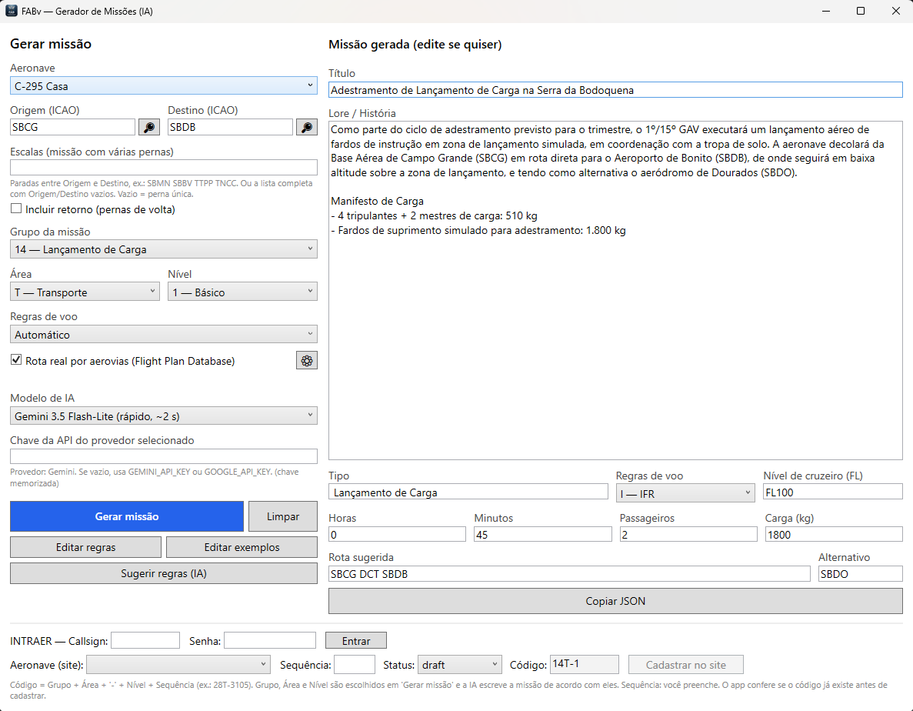
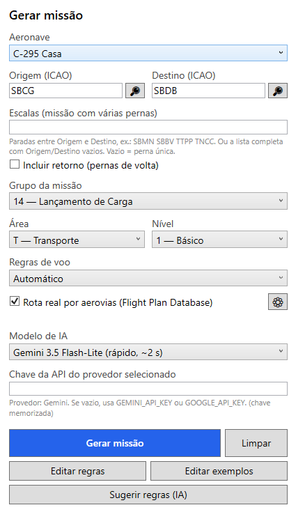
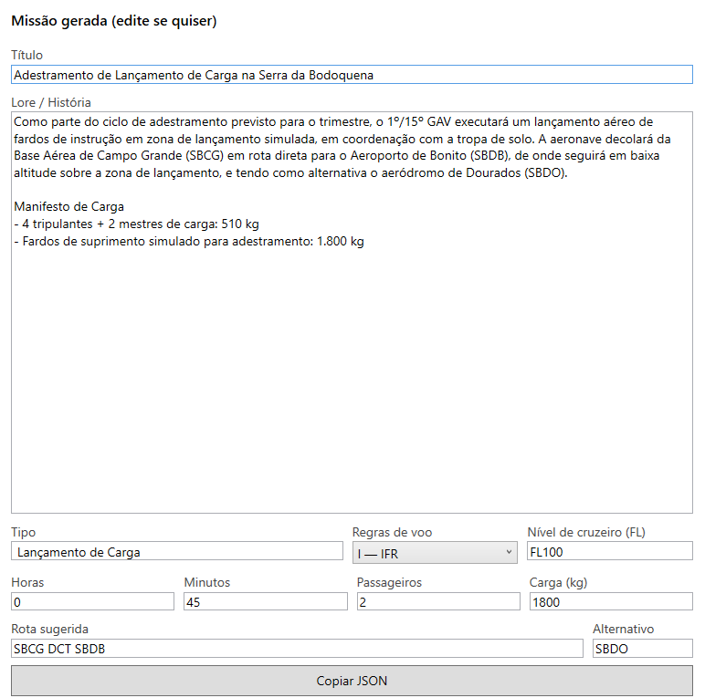
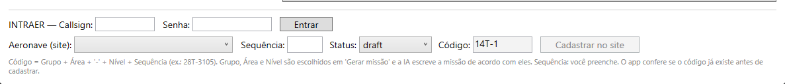

# FABv — Gerador de Missões

Aplicativo para Windows que escreve **missões da FAB Virtual** com inteligência artificial: você escolhe aeronave, origem, destino, grupo, área e nível, e o app devolve título, história (lore), manifesto de carga, rota, nível de voo e alternativo — pronto para cadastrar no site INTRAER.

**[⬇ Baixar a última versão](../../releases/latest)**

## O que você precisa

- Windows 10 ou 11 (64 bits). Não precisa instalar o .NET.
- Uma **chave de API** de um destes provedores de IA: Claude (Anthropic), Gemini (Google), ChatGPT (OpenAI) ou Grok (xAI).
- *(Opcional)* Callsign e senha do **INTRAER**, para cadastrar a missão direto pelo app.
- *(Opcional)* Chave do **Flight Plan Database**, para usar rotas reais por aerovias.

## Passo 1 — Baixar e abrir

1. Abra a página de [Releases](../../releases/latest) e baixe o arquivo `FABv.MissionGen-...-win-x64.zip`.
2. Extraia o `.zip` em uma pasta (por exemplo, `Documentos\FABv`).
3. Dê dois cliques em `FABv.MissionGen.exe`.

> Se o Windows mostrar "O Windows protegeu seu computador" (SmartScreen), clique em **Mais informações → Executar assim mesmo**. O aplicativo ainda não é assinado digitalmente.

Na primeira execução o app cria a pasta `%AppData%\FABvMissionGen` com as regras e os exemplos iniciais.

## Passo 2 — Visão geral da tela

- **Esquerda — "Gerar missão":** é onde você pede a missão.
- **Direita — "Missão gerada":** o resultado, que você pode editar antes de usar.
- **Rodapé:** login e cadastro no site INTRAER.

## Passo 3 — Pedir a missão

1. **Aeronave:** escolha o avião ou helicóptero. Cada um tem limites próprios de carga, pessoal e alcance, e a IA os respeita.
2. **Origem e Destino (ICAO):** digite os códigos de 4 letras (ex.: `SBCG` e `SBDB`). A lupa 🔎 pesquisa informações do aeroporto.
3. **Escalas:** opcional. Para uma missão com várias pernas, informe as paradas (ex.: `SBMN SBBV`). Marque **Incluir retorno** para gerar também a volta.
4. **Grupo da missão, Área e Nível:** definem o tipo de missão (ex.: `14 — Lançamento de Carga`), a área (F caça, T transporte, H helicóptero, P patrulha, I instrução) e o nível (1 Básico, 2 Avançado, 3 Noturno, 4 Operação/Exercício). Eles formam o código da missão (ex.: `14T-1`).
5. **Regras de voo:** deixe em *Automático* ou escolha I (IFR), V (VFR), Y (IFR→VFR) ou Z (VFR→IFR).
6. **Rota real por aerovias:** marcada, o app busca no Flight Plan Database a rota, o nível e o tempo reais. A engrenagem ⚙ guarda a chave desse serviço.
7. **Modelo de IA e chave da API:** escolha o modelo e cole a chave do provedor. Ela fica **memorizada, criptografada pelo Windows**, só para o seu usuário.
8. Clique em **Gerar missão**.

## Passo 4 — Revisar e copiar o resultado

> A imagem mostra o formato do resultado com a missão de exemplo "Adestramento de Lançamento de Carga".

- **Título** e **Lore / História:** o texto da missão e, no fim, o **Manifesto de Carga**. Você pode editar tudo.
- **Tipo, Regras de voo, Nível de cruzeiro, Horas, Minutos, Passageiros, Carga, Rota e Alternativo:** campos preenchidos pela IA/rota real; ajuste se precisar.
- Se aparecer um **aviso** (por exemplo, alternativo trocado), revise a lore para ficar coerente.
- **Copiar JSON** copia a missão para a área de transferência.
- **Limpar** zera o formulário.

## Passo 5 — Cadastrar no site INTRAER (opcional)

1. Digite seu **Callsign** e **Senha** do INTRAER e clique em **Entrar**.
2. Escolha a **Aeronave (site)** e informe a **Sequência** (o número final do código).
3. Confira o **Código** (grupo + área + nível + sequência, ex.: `14T-1105`) e o **Status** (`draft` ou `published`).
4. Clique em **Cadastrar no site**. O app confere se o código já existe antes de enviar.

Sua senha do site **não é guardada** pelo app.

## Passo 6 — Ajustar as regras (para quem quer personalizar)

- **Editar regras** e **Editar exemplos** abrem os arquivos no Bloco de Notas. Salvou, já vale na próxima geração.
- Linhas começando com `#` são comentários.
- Linhas `TROCAR: X => Y` corrigem automaticamente o texto da IA.
- **Sugerir regras (IA)** analisa o que você corrigiu nas missões e propõe novas regras.

> Para recomeçar com as regras padrão da versão nova, feche o app e apague (ou renomeie) `regras.txt` e `exemplos.txt` em `%AppData%\FABvMissionGen`.

## Dúvidas comuns

- **A IA citou um aeroporto errado.** O app tenta de novo sozinho; se ainda assim errar, aparece um aviso — corrija a lore.
- **O alternativo foi trocado.** O alternativo precisa existir e ficar a até 300 NM do destino; o app troca por um real e avisa.
- **Onde ficam meus dados?** Em `%AppData%\FABvMissionGen`. Para limpar tudo, apague essa pasta.

---

Projeto da comunidade FAB Virtual. Simulação — nomes e cenários são fictícios e não representam operações reais da Força Aérea Brasileira.
